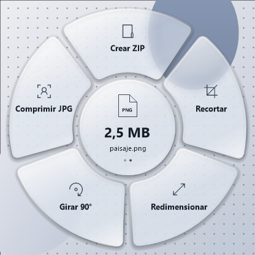

# Órbita

Órbita es una aplicación para Windows que abre una rueda de conversiones y herramientas sobre el Explorador. La rueda muestra el nombre y el tamaño del archivo seleccionado en el centro y adapta las acciones a su formato. Está escrita en C# con .NET 10 y WinUI 3.



*Vista previa de la rueda de herramientas sobre un fondo de prueba.*

## Clonar, compilar y ejecutar

Necesitas Git, PowerShell y Windows x64 (Windows 10 versión 2004 o posterior, o Windows 11). La primera compilación necesita acceso a NuGet. Ejecuta estos comandos en PowerShell:

```powershell
git clone https://github.com/Silent343/Orbita.git
cd Orbita
.\scripts\setup.ps1  # Solo si aún no tienes el SDK de .NET 10
.\scripts\build.ps1 -Test -Publish
.\publish\win-x64\Orbita.Desktop.exe
```

`setup.ps1` descarga el SDK oficial, verifica su SHA512 y lo prepara en `.tooling/dotnet`. Puedes compilar desde PowerShell o abrir `Orbita.slnx` en una versión de Visual Studio compatible con .NET 10 y WinUI.

Si ya compilaste Órbita, abre `Orbita.Desktop.exe` desde `publish/win-x64`. Para ejecutarla en otro equipo, copia la carpeta completa. La compilación está sin firmar y Smart App Control puede bloquearla. [Documentación de Smart App Control](https://learn.microsoft.com/en-us/windows/apps/develop/smart-app-control/overview).

## Activar y usar la rueda

1. Ejecuta Órbita. Busca su icono en la bandeja del sistema, junto al reloj de Windows o en el menú de iconos ocultos.
2. El atajo viene activado. Si lo desactivaste, haz clic derecho en el icono, abre **Preferencias** y enciende **Activar rueda desde el Explorador**.
3. Selecciona **un solo archivo** en el Explorador o en el escritorio y mantén presionada **Shift**. La rueda aparece tras 350 ms con la configuración predeterminada.
4. Mantén **Shift** y gira la rueda del ratón sobre el menú para recorrer las páginas de conversiones y herramientas. Haz clic en una opción para usarla. Suelta **Shift** o pulsa **Esc** para cerrar la rueda.

Los resultados se guardan en una subcarpeta `Orbita` junto al original, o en la carpeta que elijas en **Preferencias**. Órbita crea nombres nuevos para evitar sobrescrituras. Desde el menú de la bandeja puedes abrir **Preferencias** o elegir **Salir de Órbita**.

## Estado de verificación de esta entrega

El 22 de noviembre de 2026 pasaron las 20 pruebas automatizadas y la comprobación visual del ejecutable portable. El diagnóstico verificó el cambio de idioma, la navegación por la rueda y el desenfoque sobre un fondo de prueba. Queda por verificar de extremo a extremo el gesto con Shift en el Explorador. [Detalles de verificación](VERIFICATION.md).

## Funciones incluidas

| Entrada | Acciones |
| --- | --- |
| PDF | Extraer texto a TXT / Markdown; renderizar todas las páginas a PNG / JPG |
| PNG, JPG, BMP, TIFF | Convertir entre estos formatos; recortar por coordenadas; redimensionar; girar 90°; guardar JPG a calidad 75 % |
| TXT / MD | Guardar copia como TXT / MD, conservando el contenido |
| Cualquier archivo | Crear un ZIP con el archivo |

Incluye cancelación, historial local de los últimos 200 resultados, preferencias persistentes y un registro de errores. Todo se procesa en el equipo; no se envían archivos a servidores.

## Límites de esta primera versión

- PDF → Word y PowerPoint aparecen deshabilitados. Necesitan un adaptador de conversión adicional que preserve la estructura editable. No se finge una conversión cambiando la extensión.
- La extracción PDF → TXT/MD conserva texto; no reconstruye tablas, formato o títulos Markdown. Los documentos escaneados necesitan OCR, aún no incluido.
- El recorte es por coordenadas; todavía no hay editor visual de imagen, eliminación de fondo ni vista previa del recorte.
- TXT ↔ MD conserva bytes y no interpreta ni elimina la sintaxis Markdown.
- JPG coloca la transparencia sobre blanco. La compresión a calidad 75 % puede generar un archivo mayor según la entrada.
- La edición trabaja sobre una imagen / primera página TIFF, no sobre secuencias animadas o TIFF multipágina.
- El atajo usa la selección del Shell de Windows y no el portapapeles. Los gestores de archivos de terceros no están incluidos. No hay soporte para carpetas ni lotes.
- Cerrar Preferencias devuelve Órbita a la bandeja. Usa «Salir de Órbita» para detenerla.
- La distribución es una carpeta portable sin firma digital ni instalador.

## Estructura

```text
src/
  BuildingBlocks/
    Orbita.SharedKernel/       Excepciones e infraestructura mínima de notificación
    Orbita.Localization/       Contrato ILocalizer y catálogos es/en
    Orbita.Persistence/        Almacenamiento JSON atómico y serialización concurrente
  Modules/
    Files/
      Orbita.Files.Domain/          Archivo, acciones y objetos de valor
      Orbita.Files.Application/     Casos de uso, catálogo y puertos
      Orbita.Files.Infrastructure/  Adaptadores WinRT, PdfPig, ZIP y disco
    Preferences/
      Orbita.Preferences.Domain/
      Orbita.Preferences.Application/
      Orbita.Preferences.Infrastructure/
    Activity/
      Orbita.Activity.Domain/
      Orbita.Activity.Application/
      Orbita.Activity.Infrastructure/
  Orbita.Desktop/              Host, composición DI, MVVM, WinUI e integración Shell
tests/Orbita.Tests/            Pruebas de dominio, arquitectura, i18n, persistencia y conversiones
```

Consulta [ARCHITECTURE.md](ARCHITECTURE.md) para las decisiones y los puntos de extensión. Las versiones de dependencias están fijadas en los proyectos.

Los datos de ejecución se guardan en `%LOCALAPPDATA%/Orbita`: `preferences.json`, `activity.json` y `diagnostics.log`. El historial contiene nombres y rutas locales. La carpeta se puede abrir desde Preferencias.

## Verificar la interfaz

```powershell
.\publish\win-x64\Orbita.Desktop.exe --verify-ui C:\ruta\de\verificacion
```

Este modo de diagnóstico inspecciona las tres vistas, cambia el idioma durante la ejecución y comprueba la rueda sobre un fondo de prueba. Guarda las capturas y el informe `ui-verification.json` en la carpeta indicada y cierra la aplicación al terminar.

## Licencia

El código de Órbita se distribuye bajo la [licencia MIT](LICENSE). Las dependencias y herramientas de terceros conservan sus respectivas licencias.
